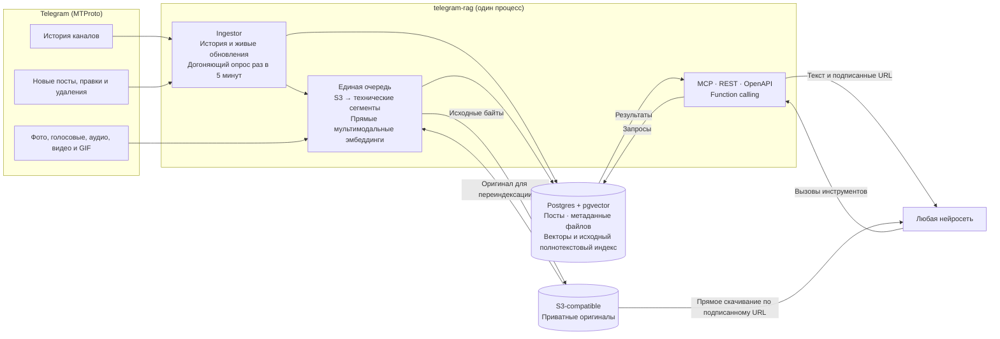

<div align="center">

<h1>telegram-rag</h1>

<p><strong>База знаний по Telegram-каналам для любых нейросетей</strong></p>

<p>Userbot собирает посты целиком, сохраняет оригиналы вложений и отдаёт их через MCP, REST и OpenAPI — с гибридным поиском по смыслу и словам.</p>

<p>
  <a href="https://github.com/42-Z/telegram-rag/actions/workflows/ci.yml"></a>
  
  
  
  
</p>

<p>
  <a href="#быстрый-старт">Быстрый старт</a> ·
  <a href="#возможности">Возможности</a> ·
  <a href="#как-это-работает">Как это работает</a> ·
  <a href="#инструменты">Инструменты</a> ·
  <a href="#подключение-нейросети">Подключение</a> ·
  <a href="#развёртывание">Развёртывание</a>
</p>

</div>

> [!NOTE]
> **Бета.** Сервис работает на живых каналах, но интерфейс инструментов и схема
> базы ещё могут меняться.

## Быстрый старт

Нужны Node.js ≥ 24.12 и ffmpeg. Для локального запуска Docker и облачная база не
нужны: PGlite создаётся в `./data`.

```bash
npm ci
cp .env.example .env         # Telegram API ID/hash, эмбеддинги и S3
npm run login                # телефон → код → (пароль 2FA) → строка сессии
                             # вставить её в .env как TELEGRAM_SESSION
npm run dev                  # локально, база — PGlite в ./data
```

`npm run login` выводит строку сессии; вставьте её в `.env` как
`TELEGRAM_SESSION`. Остальные значения — Telegram, эмбеддинги и S3 — заполняются
по комментариям в `.env.example`.

> [!TIP]
> Подробности — в разделах [медиа и S3](#медиа-и-s3), [эмбеддинги](#эмбеддинги)
> и [развёртывание](#развёртывание).

## Возможности

- **Полные посты.** Текст с разметкой, альбомы, ответы, реакции, просмотры,
  пересылки и автор.
- **Все типы вложений.** Фото, голосовые, аудио, видео, кружки и GIF получают
  векторы; стикеры, документы, контакты, опросы, геометки, раздачи, игры, счета,
  истории и другие типы Telegram сохраняются в ленте с понятными полями.
- **Любой публичный канал.** `list_posts` читает посты канала, которого нет в
  пуле: они попадают во временный кэш, не индексируются и не участвуют в поиске.
- **Гибридный поиск.** Векторы текста и медиа (pgvector) плюс полнотекстовый
  поиск по русской морфологии; результаты сливаются через Reciprocal Rank Fusion.
- **Мультимодальные эмбеддинги.** OpenRouter (`google/gemini-embedding-2`) или
  Ollama; изображения, аудио и видео индексируются напрямую, без транскрипций и
  OCR.
- **Оригиналы в S3.** MCP возвращает `resource_link`, REST — подписанные URL;
  агент скачивает файл напрямую из хранилища.
- **Один реестр инструментов.** MCP, REST, OpenAPI и function calling строятся
  из `src/tools.ts`.
- **Живое слежение.** История канала, обновления через teleproto и страховочный
  опрос.
- **Публичный или закрытый доступ.** Без `API_TOKEN` сервис открыт, с токеном —
  только по авторизации.

## Как это работает



- **История.** При добавлении канала читается вся история (или последние
  `BACKFILL_LIMIT` постов) от старых к новым, с отметкой прогресса: после
  перезапуска чтение продолжается с места остановки.
- **Живые обновления.** `client.updates.watch` из teleproto: новые посты,
  правки и удаления приходят сразу. В публичные каналы вступать не нужно.
- **Страховка.** Раз в `POLL_INTERVAL_SECONDS` дочитывается всё новее
  последнего сохранённого поста, а у последних 30 обновляются просмотры,
  реакции и правки.
- **Единая очередь индексации.** После получения поста оригинал вложения
  сохраняется в S3, затем строятся векторы исходного текста и непосредственно
  изображения, аудио или видео. При переиндексации сохранённые файлы читаются из
  S3, а не скачиваются повторно из Telegram. Если модель не принимает тип
  вложения (например, Ollama не принимает видео), оригинал всё равно сохраняется
  и отдаётся вместе с постом, найденным по тексту или другим вложениям, но
  собственного вектора у него нет.
- **Без генерации текста из медиа.** Сервис не создаёт и не индексирует
  транскрипции, описания изображений или OCR. Текстовый поиск использует текст
  поста и исходные метаданные Telegram (например, имя файла, опрос или заголовок
  веб-страницы). Содержимое документов не извлекается: PDF/DOCX/архивы доступны
  по ссылке и ищутся по имени файла, но не по тексту внутри.
- **Длинное аудио и видео** технически делится на временные сегменты. Видео и
  звук одного временного окна отправляются вместе; в найденном результате
  указывается таймкод исходного файла.
- **Поиск гибридный:** векторы текста и медиа (pgvector, косинус) и поиск по
  исходным словам (русская морфология Postgres) сливаются через Reciprocal Rank
  Fusion. Если сервис эмбеддингов временно недоступен, поиск отвечает только по
  словам и говорит об этом.
- **Каналы вне пула.** `list_posts` и `get_post` умеют читать любой публичный
  канал по `@имени` или ссылке `t.me/<имя>`, даже если его нет в пуле. Посты
  кладутся во временный кэш: в поиске они не участвуют, вложения не сохраняются
  в S3, а через час после последнего чтения кэш удаляется. Одновременно хранится
  не больше 100 таких каналов.
- **Оригиналы доступны напрямую.** MCP возвращает `resource_link`, REST — те же
  подписанные GET URL в JSON. Агент скачивает файл прямо из хранилища; сервер
  не проксирует байты. Ссылка ограничена по времени и сама по себе не шифрует
  файл.

> [!TIP]
> Фоновая очередь скачивает вложения до 100 МиБ; более крупные оригиналы (до
> 2048 МиБ) `get_post` догружает из Telegram по явному запросу. Вектор строится
> только для вложений до 100 МиБ и 1800 секунд.

## Инструменты

| Инструмент | Что делает |
|---|---|
| `list_channels` | Пул: каналы, описание, сколько постов сохранено/проиндексировано, период |
| `search_posts` | Поиск по смыслу и словам, фильтры по каналам и датам, `mode`: hybrid / semantic / keyword; стикеры, раздачи и платные медиа исключены |
| `list_posts` | Компактная лента одного канала по `@имени`, ссылке или id — в том числе вне пула: `message_id`, `link`, дата без миллисекунд, текст, вложения и альбом; без просмотров, реакций и служебных полей медиа; `media_types` выбирает документы, стикеры и другие вложения |
| `get_post` | Пост целиком по ссылке `t.me/…`: все части альбома, пост, на который он отвечает, соседние посты; недостающие оригиналы догружает из Telegram; работает и для каналов вне пула |

`list_posts` отдаёт короткую ленту: идентификатор, ссылку, дату без миллисекунд, текст, вложение и альбом. Просмотров, реакций, комментариев, ссылок на оригиналы и технических полей вроде `storage_status` или имени файла там нет — за ними агент идёт в `get_post`.

Пост отдаётся с исходным текстом и ссылкой на Telegram. Для каждого сохранённого
вложения доступны тип, имя, MIME, размер, длительность, прямой URL в S3 и срок
его действия. Для медиа-совпадения дополнительно передаются тип фрагмента и
таймкод. Альбомы, просмотры, пересылки, комментарии, реакции, источник
пересылки и автор сохраняются в выдаче.

<details>
<summary>Пример выдачи <code>get_post</code></summary>

```json
{
  "channel": "Tech News",
  "message_id": 42,
  "link": "https://t.me/tech/42",
  "date": "2026-10-20T10:15:00.000Z",
  "text": "Короткий текст поста",
  "media": {
    "type": "video",
    "file_name": "clip.mp4",
    "mime_type": "video/mp4",
    "size": 12345678,
    "duration": 42.5,
    "url": "https://storage.example/...",
    "expires_at": "2026-10-20T11:15:00.000Z"
  },
  "views": 1200,
  "forwards": 12
}
```

</details>

### Каналы вне пула

Пул — это каналы, за которыми сервис следит и которые индексирует. Любой
публичный канал можно прочитать без добавления в пул:

```json
{ "channel": "@durov", "limit": 20 }
```

`list_posts` отдаёт посты от новых к старым, `before_message_id` из
`next_before_message_id` листает вглубь, `after_message_id` добирает новее.
`get_post` по ссылке `t.me/<канал>/<id>` тоже работает для такого канала.

У каналов вне пула есть ограничения, и это осознанно:

- **Нет поиска.** Их посты не индексируются и не попадают в `search_posts`
  и статистику пула.
- **Нет архива вложений.** Байты файлов не скачиваются в S3; в ответе только
  метаданные и ссылка на пост в Telegram.
- **Временный кэш.** Посты хранятся час после последнего чтения, затем
  удаляются вместе с каналом. Если кэш вырос больше 100 каналов, первыми уходят
  давно не читанные. `list_posts` и `get_post` каждый раз читают Telegram
  заново; кэш нужен, чтобы пережить кратковременную недоступность Telegram.
- **Только публичные каналы.** По `@имени` или `t.me/<имя>`; приглашения
  `t.me/+…` не принимаются, чтобы сервис не вступал в закрытые чаты.

## Подключение нейросети

Одни и те же инструменты доступны тремя способами — выбирайте тот, который
понимает ваша модель или клиент.

| Способ | Кому подходит | Точка входа |
|---|---|---|
| **MCP** | Claude (Desktop, Code, claude.ai), ChatGPT, Cursor, Windsurf, LM Studio, Cline, Continue, n8n | `POST /mcp` |
| **Function calling** | OpenAI, Gemini, Claude, Mistral, DeepSeek, Qwen, Llama через Ollama/vLLM/OpenRouter | `GET /api/tools` |
| **OpenAPI** | GPT Actions, Dify, Flowise, LangChain `OpenAPIToolkit` | `GET /openapi.json` |

### MCP

```json
{
  "mcpServers": {
    "telegram-rag": {
      "type": "http",
      "url": "https://<адрес>/mcp",
      "headers": { "Authorization": "Bearer <API_TOKEN>" }
    }
  }
}
```

Клиенту, который умеет только stdio: `npx mcp-remote https://<адрес>/mcp`.
Клиенту, который не умеет заголовки: `https://<адрес>/mcp?token=<API_TOKEN>`.

### Function calling

Описания функций готовы в нужном формате:

```bash
curl https://<адрес>/api/tools                    # OpenAI / OpenRouter / Ollama / vLLM / Mistral / Groq
curl https://<адрес>/api/tools?format=anthropic   # Claude API
curl https://<адрес>/api/tools?format=gemini      # Gemini API
```

Модель просит вызвать функцию → ваш код отправляет её аргументы сюда:

```bash
curl -X POST https://<адрес>/api/tools/search_posts \
  -H 'Authorization: Bearer <API_TOKEN>' -H 'Content-Type: application/json' \
  -d '{"query": "что писали про новые видеокарты", "limit": 5}'
```

### OpenAPI

`https://<адрес>/openapi.json` — для GPT Actions в ChatGPT, Dify, Flowise,
LangChain `OpenAPIToolkit` и любых агентов, которые читают OpenAPI.

Для людей и отладки: `GET /api/search?q=…&channels=@a,@b&from=2026-01-01&limit=5`.
Сводка всех адресов — `GET /`.

> [!IMPORTANT]
> **Публичный доступ.** Если `API_TOKEN` не задан, MCP и API открыты всем и дают
> полные возможности, включая чтение любых публичных каналов по запросу и догрузку
> оригиналов через `get_post` — до 2048 МиБ на вложение. Это расходует трафик
> Telegram и место в S3. Если такой доступ нежелателен, задайте `API_TOKEN`.

## Управление пулом

Каналы задаются в `TELEGRAM_CHANNELS` (добавляются при старте) или на лету,
с токеном владельца `ADMIN_TOKEN`:

```bash
# добавить (публичный — по имени/ссылке; закрытый — по приглашению, аккаунт вступит)
curl -X POST https://<адрес>/api/admin/channels -H 'Authorization: Bearer <ADMIN_TOKEN>' \
  -H 'Content-Type: application/json' -d '{"refs": ["@durov", "https://t.me/+AbCdEf"]}'

curl https://<адрес>/api/admin/channels -H 'Authorization: Bearer <ADMIN_TOKEN>'         # пул, кэш каналов вне пула, очередь индексации
curl -X DELETE 'https://<адрес>/api/admin/channels/@durov' -H '…'                          # перестать следить (посты остаются)
curl -X DELETE 'https://<адрес>/api/admin/channels/@durov?purge=1' -H '…'                  # и удалить посты
curl -X POST https://<адрес>/api/admin/sync -H '…'                                         # опросить каналы сейчас
curl -X POST https://<адрес>/api/admin/retry-failed -H '…'                                 # переиндексировать упавшие
```

## Запуск

### Что нужно

| Компонент | Зачем |
|---|---|
| Node.js ≥ 24.12 | исполняет TypeScript напрямую, без сборки |
| `ffmpeg` и `ffprobe` | длительность, сегменты и подготовка медиа |
| Telegram API ID и hash | userbot |
| S3-compatible bucket | оригиналы вложений |
| OpenRouter или Ollama | мультимодальные эмбеддинги |

```bash
npm ci
cp .env.example .env         # заполнить Telegram, эмбеддинги (OpenRouter или Ollama) и S3
npm run login                # телефон → код → (пароль 2FA) → строка сессии
                             # вставить её в .env как TELEGRAM_SESSION
npm run dev                  # локально, база — PGlite в ./data, Docker не нужен
```

### База

База — любой Postgres с pgvector по строке `DATABASE_URL`: в бою облачная
(Supabase или Neon), локально — встроенная PGlite в `./data` или контейнер
(`docker compose up --build` поднимает приложение и Postgres с pgvector).
Схему сервис создаёт сам.

### Аккаунт для userbot'а

Лучше отдельный аккаунт, а не личный: сессия даёт полный доступ к нему. Одна
сессия — один запущенный процесс: две копии с одной сессией выбивают друг
друга. Для локальной разработки заводите вторую сессию (`npm run login` ещё
раз).

### Медиа и S3

Приложение сохраняет оригиналы вложений (фото, голосовые, кружки, аудио, видео,
GIF, стикеры и документы) в приватный S3-compatible bucket: фоново — до 100 МиБ,
более крупные (до 2048 МиБ) — по явному запросу `get_post`. Индексируются
напрямую те, что умеет модель (`EMBEDDING_MODALITIES`), вместе с исходным текстом
поста. Вложения остальных типов остаются в архиве и отдаются вместе с постом, но
без своего вектора. Стикеры и документы тоже архивируются, но векторов не
получают: у них есть тип, имя файла и прямая ссылка. Отдельной настройки «какие
типы хранить» нет; старая `MEDIA_TYPES` отвергается при запуске. S3 обязателен:
нужны `S3_REGION`, `S3_BUCKET`, `S3_ACCESS_KEY_ID` и `S3_SECRET_ACCESS_KEY`;
`S3_ENDPOINT` задаётся для нестандартного S3 API. Для Neon Object Storage
используйте endpoint текущей ветки и `S3_FORCE_PATH_STYLE=true`. Bucket должен
быть приватным, а endpoint — доступным агентам, которым будут выдаваться прямые
ссылки.

Посты со стикерами, раздачами и платными медиа видны в `list_posts`, но
исключены из `search_posts` целиком, включая подпись. Контакты, кубики, игры,
счета, истории, todo-списки и другие типы сохраняют свои поля в ленте; документы
ищутся по имени файла. Выбрать вложения конкретного типа можно через
`media_types` у `list_posts`, например `{"channel": "@news", "media_types": ["document"]}`.

В Postgres хранится ключ объекта и метаданные, но не сами байты и не готовые
ссылки. URL подписывается при выдаче, действует `S3_URL_TTL_SECONDS` секунд
(по умолчанию 3600, максимум 604800) и скачивается напрямую из S3. Любой
обладатель ссылки может скачать файл до её истечения. Подпись ограничивает
доступ по времени, но не шифрует содержимое; прикладного шифрования файлов
сервис не добавляет.

`MEDIA_SINCE` ограничивает дату медиаэмбеддингов, но оригиналы постов старше
этой даты всё равно архивируются. Фоновая очередь скачивает вложения до
100 МиБ; файлы крупнее (до 2048 МиБ) она не трогает, а `get_post` догружает их
из Telegram по явному запросу. Вектор строится только для вложений до 100 МиБ и
1800 секунд: более крупные и длинные файлы остаются доступны по ссылке, но в
поиске по смыслу не участвуют. Переменные `MEDIA_MAX_MB` и `MEDIA_MAX_SECONDS`
больше не используются: если они остались в старом `.env`, сервис их игнорирует.
Сбой вложения (скачивание, S3, подготовка файла, эмбеддинг) не мешает индексации
текста поста: вложение получает статус `failed` или `skipped`, а пост остаётся в
поиске. Пропуски и ошибки видны в `GET /health` и `GET /api/admin/channels`;
`POST /api/admin/retry-failed` повторяет неудачные этапы, не загружая заново уже
сохранённые оригиналы.

Длинные записи делятся на сегменты `MEDIA_SEGMENT_SECONDS` с перекрытием
`MEDIA_SEGMENT_OVERLAP_SECONDS` (по умолчанию 60 и 5 секунд). Видео и аудиодорожка
одного окна эмбеддятся вместе. Нужны `ffmpeg` и `ffprobe` (в Docker-образе есть;
локально — `brew install ffmpeg`).

### Эмбеддинги

Поддерживаются только мультимодальные модели: текст плюс картинки, звук и/или
видео. Текстовые модели не подходят. Бэкенд выбирают переменные: задан
`OPENROUTER_API_KEY` — OpenRouter, задан `EMBEDDING_BASE_URL` — Ollama; нужна
ровно одна из двух, обе сразу — ошибка конфигурации.

**OpenRouter** — по умолчанию `google/gemini-embedding-2`, вектор 1536. Запросы
идут в `/embeddings` с типизированным `input` для `image_url`, `input_audio` и
`input_video`.

**Ollama** — нативный `POST /api/embed`, в котором элемент `input` — строка или
объект `{text, image, audio}` с base64. Эта возможность появилась в Ollama в
октябре 2026 года, нужна свежая версия и мультимодальная модель, например
`embeddinggemma-2`. Модель и размер вектора обязательны, ключ нужен только за
прокси или для Ollama Cloud:

```bash
EMBEDDING_BASE_URL=http://ollama:11434
EMBEDDING_MODEL=embeddinggemma-2
EMBEDDING_DIMENSIONS=768
```

Видео Ollama не принимает, а теги модели различаются набором «башен» (например,
тег без зрения не примет картинки). Поэтому `EMBEDDING_MODALITIES` перечисляет,
что модель умеет: `image`, `audio`, `video`; по умолчанию у OpenRouter все три, у
Ollama `image,audio`. Вложения остальных типов не обрабатываются моделью: оригинал
сохраняется в S3 и отдаётся вместе с постом, у них статус `skipped` и причина, а
текст поста индексируется как обычно. Эндпоинты с другим форматом запроса
(OpenAI, vLLM и т. п.) не поддерживаются.

`EMBEDDING_MAX_REQUEST_MB` ограничивает размер JSON с base64-данными и разбивает
большие пачки.

Смена модели, размерности, набора модальностей или параметров сегментации
пересоздаёт векторы при старте. Пространства `gemini-embedding-001` и
`gemini-embedding-2` несовместимы; после перехода сервис заново индексирует
исходный текст и уже сохранённые медиа. Если оригинал ещё не сохранён, сервис
скачивает его из Telegram; удалённые или недоступные там файлы автоматически
восстановить нельзя.

## Развёртывание

Боевое развёртывание на VPS с облачной базой: образ собирается в GitHub Actions
и публикуется в GHCR, системный Caddy отдаёт домен наружу, а `deploy.sh` ждёт
здоровья контейнера и при неудаче откатывается на прежний тег.

| Что | Как |
|---|---|
| Образ | GitHub Actions → GHCR |
| База | Supabase или Neon с pgvector |
| Прокси | Caddy |
| Откат | автоматический при неудачном healthcheck |

Подробная инструкция — [deploy/README.md](./deploy/README.md).

## Разработка

```bash
npm test             # логика + сервис целиком: PGlite с pgvector, HTTP, настоящий MCP-клиент
npm run typecheck
```

Проверки не ходят в облака: база — PGlite в памяти, эмбеддинги, S3 и клиент
Telegram — локальные подмены. `ffmpeg`/`ffprobe` настоящие и обрабатывают
сгенерированные фото, голосовые, видео и GIF.

## Структура

```text
src/
  main.ts              вход: база → единая очередь → userbot → HTTP
  config.ts            переменные окружения
  db.ts                Postgres (Supabase, Neon, свой) / PGlite, схема, переиндексация при смене модели
  store.ts             каналы, посты, куски, поиск по смыслу и словам
  embeddings.ts        прямой text/multimodal embeddings API
  chunks.ts            нарезка поста на куски с шапкой «канал, дата»
  indexer.ts           единая очередь: Telegram → S3 → ffmpeg → векторы
  storage.ts           S3-compatible оригиналы и подписанные ссылки
  presentation.ts      общий DTO постов и прямых media URL для REST/MCP
  tools.ts             инструменты для нейросетей — одни на все способы подключения
  mcp.ts               MCP-сервер (Streamable HTTP, без сессий)
  http.ts              REST, OpenAPI, function calling, управление пулом
  media/
    ffmpeg.ts          MIME/длительность, технические сегменты и форматирование
    prepare.ts         прямые image/audio/video части для эмбеддингов
    limits.ts          пределы архива и векторного поиска
  telegram/
    client.ts          клиент teleproto, поиск канала по имени/приглашению/id
    ingest.ts          история, живые обновления, догоняющий опрос
    reader.ts          каналы вне пула: чтение из Telegram и временный кэш
    normalize.ts       сообщение MTProto → пост
  cli/login.ts         вход в аккаунт и строка сессии
tests/                 Vitest
deploy/                VPS: compose, выкатка с откатом, Caddy
```
