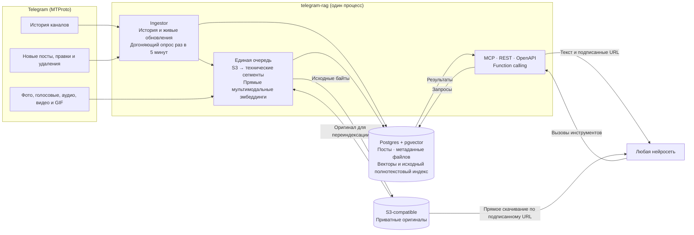

# telegram-rag

> **Бета.** Работает на живых каналах, но интерфейс инструментов и схема
> базы ещё могут меняться. Выкатка на сервер — вручную.

База знаний по Telegram-каналам для любых нейросетей. Сервис через userbot
(teleproto) постоянно следит за пулом каналов, сохраняет каждый пост целиком,
строит эмбеддинги и отдаёт посты ассистентам: через MCP, REST/OpenAPI и
готовые описания функций для function calling.

## Как это работает



- **История.** При добавлении канала читается вся история (или последние
  `BACKFILL_LIMIT` постов) от старых к новым, с отметкой прогресса: после
  перезапуска чтение продолжается с места остановки.
- **Живые обновления.** `client.updates.watch` из teleproto: новые посты,
  правки и удаления приходят сразу. В публичные каналы вступать не нужно.
- **Страховка.** Раз в `POLL_INTERVAL_SECONDS` дочитывается всё новее
  последнего сохранённого поста, а у последних 30 обновляются просмотры,
  реакции и правки.
- **Единая очередь индексации.** После получения поста оригинал вложения
  сохраняется в S3, затем строятся векторы исходного текста и непосредственно
  изображения, аудио или видео. При переиндексации сохранённые файлы читаются из
  S3, а не скачиваются повторно из Telegram.
- **Без генерации текста из медиа.** Сервис не создаёт и не индексирует
  транскрипции, описания изображений или OCR. Текстовый поиск использует текст
  поста и исходные метаданные Telegram (например, имя файла, опрос или заголовок
  веб-страницы).
- **Длинное аудио и видео** технически делится на временные сегменты. Видео и
  звук одного временного окна отправляются вместе; в найденном результате
  указывается таймкод исходного файла.
- **Поиск гибридный:** векторы текста и медиа (pgvector, косинус) и поиск по
  исходным словам (русская морфология Postgres) сливаются через Reciprocal Rank
  Fusion. Без ключа эмбеддингов S3-архивирование продолжает работать, а поиск
  доступен по словам.
- **Оригиналы доступны напрямую.** MCP возвращает `resource_link`, REST — те же
  подписанные GET URL в JSON. Агент скачивает файл прямо из хранилища; сервер
  не проксирует байты. Ссылка ограничена по времени и сама по себе не шифрует
  файл.

## Что видит нейросеть

| Инструмент | Что делает |
|---|---|
| `list_channels` | Пул: каналы, описание, сколько постов сохранено/проиндексировано, период |
| `search_posts` | Поиск по смыслу и словам, фильтры по каналам и датам, `mode`: hybrid / semantic / keyword |
| `list_posts` | Лента по времени: за период, по каналам, от новых или от старых, с перелистыванием |
| `get_post` | Пост целиком по ссылке `t.me/…`: все части альбома, пост, на который он отвечает, соседние посты |

Пост отдаётся с исходным текстом и ссылкой на Telegram. Для каждого сохранённого
вложения доступны тип, имя, MIME, размер, длительность, прямой URL в S3 и срок
его действия. Для медиа-совпадения дополнительно передаются тип фрагмента и
таймкод. Альбомы, просмотры, пересылки, комментарии, реакции, источник
пересылки и автор сохраняются в выдаче.

## Подключение нейросети

Одни и те же инструменты доступны тремя способами — выбирайте тот, который
понимает ваша модель или клиент.

**1. MCP** — Claude (Desktop, Code, claude.ai), ChatGPT, Cursor, Windsurf,
LM Studio, Cline, Continue, n8n и любые MCP-клиенты:

```json
{
  "mcpServers": {
    "telegram-rag": {
      "type": "http",
      "url": "https://<адрес>/mcp",
      "headers": { "Authorization": "Bearer <API_TOKEN>" }
    }
  }
}
```

Клиенту, который умеет только stdio: `npx mcp-remote https://<адрес>/mcp`.
Клиенту, который не умеет заголовки: `https://<адрес>/mcp?token=<API_TOKEN>`.

**2. Function calling** — любая модель, умеющая вызывать функции (OpenAI,
Gemini, Claude, Mistral, DeepSeek, Qwen, Llama через Ollama/vLLM, всё через
OpenRouter). Описания функций готовы в нужном формате:

```bash
curl https://<адрес>/api/tools                    # OpenAI / OpenRouter / Ollama / vLLM / Mistral / Groq
curl https://<адрес>/api/tools?format=anthropic   # Claude API
curl https://<адрес>/api/tools?format=gemini      # Gemini API
```

Модель просит вызвать функцию → ваш код отправляет её аргументы сюда:

```bash
curl -X POST https://<адрес>/api/tools/search_posts \
  -H 'Authorization: Bearer <API_TOKEN>' -H 'Content-Type: application/json' \
  -d '{"query": "что писали про новые видеокарты", "limit": 5}'
```

**3. OpenAPI** — `https://<адрес>/openapi.json`: GPT Actions в ChatGPT, Dify,
Flowise, LangChain `OpenAPIToolkit` и любые агенты, которые читают OpenAPI.

Для людей и отладки: `GET /api/search?q=…&channels=@a,@b&from=2026-01-01&limit=5`.
Сводка всех адресов — `GET /`.

## Управление пулом

Каналы задаются в `TELEGRAM_CHANNELS` (добавляются при старте) или на лету,
с токеном владельца `ADMIN_TOKEN`:

```bash
# добавить (публичный — по имени/ссылке; закрытый — по приглашению, аккаунт вступит)
curl -X POST https://<адрес>/api/admin/channels -H 'Authorization: Bearer <ADMIN_TOKEN>' \
  -H 'Content-Type: application/json' -d '{"refs": ["@durov", "https://t.me/+AbCdEf"]}'

curl https://<адрес>/api/admin/channels -H 'Authorization: Bearer <ADMIN_TOKEN>'         # пул и очередь индексации
curl -X DELETE 'https://<адрес>/api/admin/channels/@durov' -H '…'                          # перестать следить (посты остаются)
curl -X DELETE 'https://<адрес>/api/admin/channels/@durov?purge=1' -H '…'                  # и удалить посты
curl -X POST https://<адрес>/api/admin/sync -H '…'                                         # опросить каналы сейчас
curl -X POST https://<адрес>/api/admin/retry-failed -H '…'                                 # переиндексировать упавшие
```

## Запуск

Нужны Node.js ≥ 24.12 (TypeScript исполняется напрямую, без сборки) и ffmpeg.

```bash
npm ci
cp .env.example .env         # заполнить Telegram/OpenRouter и S3; либо MEDIA_TYPES= для text-only
npm run login                # телефон → код → (пароль 2FA) → строка сессии
                             # вставить её в .env как TELEGRAM_SESSION
npm run dev                  # локально, база — PGlite в ./data, Docker не нужен
```

База — любой Postgres с pgvector по строке `DATABASE_URL`: в бою облачная
(Supabase или Neon), локально — встроенная PGlite в `./data` или контейнер
(`docker compose up --build` поднимает приложение и Postgres с pgvector).
Схему сервис создаёт сам.

Боевое развёртывание на VPS с облачной базой — как завести Supabase или Neon и чем они отличаются по лимитам (образ из GHCR, системный Caddy, автоматический
откат) — [deploy/README.md](./deploy/README.md).

### Аккаунт для userbot'а

Лучше отдельный аккаунт, а не личный: сессия даёт полный доступ к нему. Одна
сессия — один запущенный процесс: две копии с одной сессией выбивают друг
друга. Для локальной разработки заводите вторую сессию (`npm run login` ещё
раз).

### Медиа и S3

`MEDIA_TYPES` по умолчанию включает `photo,voice,video_note,audio,video,gif`.
Для этих типов приложение сохраняет оригинал в приватный S3-compatible bucket,
затем индексирует его напрямую вместе с исходным текстом поста. Для выбранных
типов медиа обязательны `S3_REGION`, `S3_BUCKET`, `S3_ACCESS_KEY_ID` и
`S3_SECRET_ACCESS_KEY`; `S3_ENDPOINT` задаётся для нестандартного S3 API. Для
Neon Object Storage используйте endpoint текущей ветки и `S3_FORCE_PATH_STYLE=true`.
Bucket должен быть приватным, а endpoint — доступным агентам, которым будут
выдаваться прямые ссылки.

В Postgres хранится ключ объекта и метаданные, но не сами байты и не готовые
ссылки. URL подписывается при выдаче, действует `S3_URL_TTL_SECONDS` секунд
(по умолчанию 3600, максимум 604800) и скачивается напрямую из S3. Любой
обладатель ссылки может скачать файл до её истечения. Подпись ограничивает
доступ по времени, но не шифрует содержимое; прикладного шифрования файлов
сервис не добавляет.

`MEDIA_SINCE` ограничивает дату медиаэмбеддингов, но оригиналы постов старше
этой даты всё равно архивируются. `MEDIA_MAX_MB` ограничивает размер файла,
который будет сохранён и обработан; `MEDIA_MAX_SECONDS` ограничивает длительность
индексации. Пропуски и ошибки видны в `GET /health` и
`GET /api/admin/channels`; `POST /api/admin/retry-failed` повторяет неудачные
этапы, не загружая заново уже сохранённые оригиналы.

Длинные записи делятся на сегменты `MEDIA_SEGMENT_SECONDS` с перекрытием
`MEDIA_SEGMENT_OVERLAP_SECONDS` (по умолчанию 60 и 5 секунд). Видео и аудиодорожка
одного окна эмбеддятся вместе. Нужны `ffmpeg` и `ffprobe` (в Docker-образе есть;
локально — `brew install ffmpeg`). Если `MEDIA_TYPES` пуст, медиа не скачиваются,
не архивируются и не индексируются.

### Эмбеддинги

По умолчанию `google/gemini-embedding-2` через OpenRouter, вектор 1536.
Мультимодальный endpoint должен принимать типизированный `/embeddings` input
для `image_url`, `input_audio` и `input_video`; текстовый endpoint без этих
типов сможет индексировать только текст. `EMBEDDING_MAX_REQUEST_MB` ограничивает
размер JSON с base64-данными и разбивает большие пачки.

Другой OpenAI-совместимый endpoint подключается переменными `EMBEDDING_*` —
например, локальная Ollama (только текст):

```bash
EMBEDDING_BASE_URL=http://ollama:11434/v1
EMBEDDING_MODEL=nomic-embed-text
EMBEDDING_DIMENSIONS=768
EMBEDDING_SEND_DIMENSIONS=false
```

Смена модели, размерности или параметров сегментации пересоздаёт векторы при
старте. Пространства `gemini-embedding-001` и `gemini-embedding-2` несовместимы;
после перехода сервис заново индексирует исходный текст и уже сохранённые медиа.
Если оригинал ещё не сохранён, сервис скачивает его из Telegram; удалённые или
недоступные там файлы автоматически восстановить нельзя.

## Разработка

```bash
npm test             # логика + сервис целиком: PGlite с pgvector, HTTP, настоящий MCP-клиент
npm run typecheck
```

Проверки не ходят в облака: база — PGlite в памяти, эмбеддинги, S3 и клиент
Telegram — локальные подмены. `ffmpeg`/`ffprobe` настоящие и обрабатывают
сгенерированные фото, голосовые, видео и GIF.

## Структура

```
src/
  main.ts              вход: база → единая очередь → userbot → HTTP
  config.ts            переменные окружения
  db.ts                Postgres (Supabase, Neon, свой) / PGlite, схема, переиндексация при смене модели
  store.ts             каналы, посты, куски, поиск по смыслу и словам
  embeddings.ts        прямой text/multimodal embeddings API
  chunks.ts            нарезка поста на куски с шапкой «канал, дата»
  indexer.ts           единая очередь: Telegram → S3 → ffmpeg → векторы
  storage.ts           S3-compatible оригиналы и подписанные ссылки
  presentation.ts      общий DTO постов и прямых media URL для REST/MCP
  tools.ts             инструменты для нейросетей — одни на все способы подключения
  mcp.ts               MCP-сервер (Streamable HTTP, без сессий)
  http.ts              REST, OpenAPI, function calling, управление пулом
  media/
    ffmpeg.ts          MIME/длительность, технические сегменты и форматирование
    prepare.ts         прямые image/audio/video части для эмбеддингов
  telegram/
    client.ts          клиент teleproto, поиск канала по имени/приглашению/id
    ingest.ts          история, живые обновления, догоняющий опрос
    normalize.ts       сообщение MTProto → пост
  cli/login.ts         вход в аккаунт и строка сессии
tests/                 Vitest
deploy/                VPS: compose, выкатка с откатом, Caddy
```
